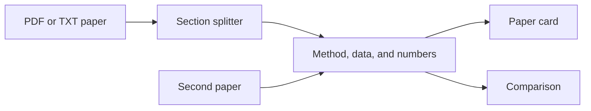

# Research Paper Agent

[](https://www.python.org/)
[](https://gradio.app/)

Upload a paper and the agent returns the problem, the method, the dataset, and the numbers it reports. Upload a second paper and it compares the two. The practice papers are about talking-face animation and 3D face reconstruction. They are not real publications.

The reader works from the paper text, with no API key. A Groq key is optional and only cleans the wording.

## How it works



1. The loader reads a PDF or a text file.
2. The splitter finds the abstract, method, experiments, and conclusion.
3. The reader keeps the problem, the method, named datasets, reported numbers, and a limitation.
4. A second paper produces the same card, plus the datasets and numbers they share.
5. Save the reading. The library keeps every paper and writes notes you can paste.

## Run it

```powershell
python -m venv .venv
.\.venv\Scripts\python -m pip install -r requirements.txt
.\.venv\Scripts\python app.py
```

Open http://127.0.0.1:7861

Click **Show the practice papers**, or upload your own PDF. The agent does not train a model and it does not need a face photo.

## Optional language model

```powershell
copy .env.example .env
```

Put a Groq key in `GROQ_API_KEY`, turn on the checkbox, and read the paper again. If the key is empty, or the call fails, the text reader is used.

## Check it

```powershell
.\.venv\Scripts\python -m unittest discover -s tests -v
```

## Project layout

| File | Role |
| --- | --- |
| `app.py` | Gradio interface |
| `research_paper/read.py` | PDF and TXT loading |
| `research_paper/sections.py` | Abstract, method, experiments, conclusion |
| `research_paper/extract.py` | Problem, method, datasets, numbers, limitation |
| `research_paper/compare.py` | What two papers share |
| `research_paper/library.py` | Saved readings and pasteable notes |
| `research_paper/llm.py` | Optional cleanup when a key is set |
| `research_paper/samples.py` | Two practice papers |
| `tests/` | Checks on those practice papers |
